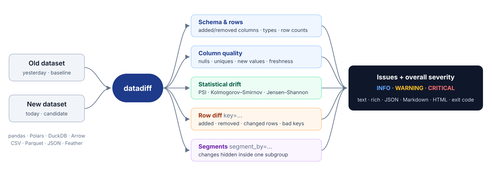

<p align="center">
  
</p>

<p align="center">
  <a href="https://pypi.org/project/datadiff-engine/"></a>
  <a href="https://github.com/Rohesen/datadiff-engine/actions/workflows/tests.yml"></a>
  <a href="https://www.python.org/"></a>
  <a href="https://github.com/Rohesen/datadiff-engine/blob/main/LICENSE.txt"></a>
  <a href="https://pypi.org/project/datadiff-engine/"></a>
</p>

<p align="center">
  <a href="#-install">Install</a> ·
  <a href="#-quick-start">Quick start</a> ·
  <a href="#-python-api">Python API</a> ·
  <a href="#-cli">CLI</a> ·
  <a href="#-statistical-drift">Drift</a> ·
  <a href="#-row-level-diff">Row diff</a> ·
  <a href="#-segment-analysis">Segments</a> ·
  <a href="#-drift-methodology">Methodology</a> ·
  <a href="#%EF%B8%8F-roadmap">Roadmap</a> ·
  <a href="https://github.com/Rohesen/datadiff-agent">AI agent built on it</a>
</p>

<p align="center">
  
</p>

---

## 🔍 Overview

> **Data pipelines can produce outputs that are technically valid but unexpectedly different.**

`datadiff-engine` compares two datasets and makes those differences visible, so you can catch silent regressions before they reach downstream consumers.

| Check | What it catches |
|---|---|
| Row counts | Unexpected growth or drops |
| Schema | Added or removed columns, data-type changes |
| Null rates | Silent data-quality regressions |
| Unique values | Cardinality changes and collapsed columns |
| Numeric statistics | Shifts in summary statistics |
| Numeric drift | Relative change in mean, median and P95 |
| Statistical drift | Distribution shifts via PSI, Kolmogorov–Smirnov and Jensen–Shannon |
| Categoricals | New values and changes in category mix |
| Row-level diff | Added, removed and changed rows by key, duplicate and null keys |
| Segments | Problems hidden inside one subgroup (a country, a channel...) |
| Freshness | Timestamps that did not move forward (stale loads) |
| Severity | Configurable warning and critical thresholds |

Output is available as a Python object, a terminal report (plain or coloured), JSON, Markdown or a self-contained HTML page. It accepts pandas, Polars, DuckDB and PyArrow tables, and the CLI reads CSV, TSV, Parquet, JSON, JSON Lines, Feather and DuckDB tables.

<p align="center">
  
</p>

## 📦 Install

```bash
pip install datadiff-engine
```

Requires Python 3.10 or newer. Optional extras:

| Extra | Adds |
|---|---|
| `datadiff-engine[parquet]` | Parquet and Feather files (pyarrow) |
| `datadiff-engine[polars]` | Polars DataFrame / LazyFrame inputs |
| `datadiff-engine[duckdb]` | DuckDB relations and `--duckdb` in the CLI |
| `datadiff-engine[rich]` | Coloured terminal output (`--format rich`) |
| `datadiff-engine[all]` | All of the above |

## 🚀 Quick start

Compare two files from the command line:

```bash
datadiff examples/orders_old.csv examples/orders_new.csv
```

Or compare two DataFrames in Python:

```python
import pandas as pd

from datadiff_engine import compare

old = pd.DataFrame({
    "customer_id": [1, 2, 3],
    "amount": [100, 200, 300],
})

new = pd.DataFrame({
    "customer_id": [1, 2, 3, 4],
    "amount": [100, 200, None, 500],
    "country": ["IN", "IN", "US", "IN"],
})

diff = compare(old, new)

print(diff)
```
In this example the comparison reports that the row count grew from 3 to 4, a new `country` column appeared, and `amount` gained a null value. With datasets this small the statistical tests are skipped; they need at least `min_rows_for_tests` (default 50) values per side.

Output:

```text
DATASET DIFF
========================================

OVERALL SEVERITY: CRITICAL
  [CRITICAL] Null rate in 'amount' rose 0.0% → 25.0%.
  [WARNING] Row count changed 3 → 4 (+33.3%).
  [WARNING] Numeric drift in 'amount': mean +33.3%, median +0.0%, p95 +62.1%.
  [WARNING] Numeric drift in 'customer_id': mean +25.0%, median +25.0%, p95 +32.8%.
  [INFO] Column 'country' was added.
  [INFO] Column 'amount' changed type int64 → float64 because it now contains missing values (values are still whole numbers).

ROWS
  3 → 4
  Change: +1 (+33.33%)

SCHEMA
  + Added:   ['country']
  - Removed: none
  ~ Changed: amount (int64 → float64)

COLUMN CHANGES
----------------------------------------
amount
  Data type: int64 → float64
  Null rate: 0.00% → 25.00% (+25.00 pp)
  Severity:  CRITICAL

  Statistics
    Mean:    200.00 → 266.67
    Median:  200.00 → 200.00
    Min:     100.00 → 100.00
    Max:     300.00 → 500.00
    P95:     290.00 → 470.00

customer_id
  Unique values: 3 → 4 (+1)
  Severity:  INFO

  Statistics
    Mean:    2.00 → 2.50
    Median:  2.00 → 2.50
    Min:     1.00 → 1.00
    Max:     3.00 → 4.00
    P95:     2.90 → 3.85
```

## 🐍 Python API

### Column-level analysis

```python
amount = diff.column("amount")

print(amount.old_dtype)
print(amount.new_dtype)

print(amount.null_rate_old)
print(amount.null_rate_new)
print(amount.null_rate_change)

print(amount.severity)
```

### Numeric statistics and drift

```python
if amount.old_stats and amount.new_stats:
    print(amount.old_stats.mean)
    print(amount.new_stats.mean)

if amount.drift:
    print(amount.drift.mean_change_pct)
    print(amount.drift.has_drift)
```

### Custom thresholds

```python
from datadiff_engine import DiffConfig, compare

config = DiffConfig(
    warning_null_rate=0.10,
    critical_null_rate=0.50,
)

diff = compare(old, new, config=config)
```

### Excluding identifier columns from numeric drift

```python
config = DiffConfig(
    ignored_columns={"customer_id"},
)

diff = compare(old, new, config=config)
```

The column remains part of the comparison; only numeric drift analysis is skipped for it.

### Issues and overall severity

Every diff can summarise itself as a list of issues, most severe first, plus one overall severity. This is the easiest thing to act on in a pipeline, an alert, or an AI agent.

```python
for issue in diff.issues():
    print(issue.severity, issue.kind, issue.column, issue.message)

if diff.overall_severity == "CRITICAL":
    raise RuntimeError("Bad batch, not loading it")
```

| Issue kind | When | Severity |
|---|---|---|
| `empty_dataset` | new dataset has no rows (old one had some) | 🔴 CRITICAL |
| `row_count_change` | row count moved past the configured % | 🟡 WARNING / 🔴 CRITICAL |
| `column_removed` | a column disappeared | 🔴 CRITICAL |
| `column_added` | a new column appeared | 🔵 INFO |
| `type_changed` | a column's data type changed | 🟡 WARNING |
| `null_rate_increase` | null rate rose past the configured thresholds | 🟡 WARNING / 🔴 CRITICAL |
| `new_category_values` | a low-cardinality text column (status, currency, channel...) has values never seen before | 🟡 WARNING |
| `numeric_drift` | mean, median or p95 moved past `drift_threshold_pct` | 🟡 WARNING |
| `distribution_drift` | PSI past `psi_warning` / `psi_critical` (numeric columns also need a significant KS test) | 🟡 WARNING / 🔴 CRITICAL |
| `stale_data` | latest timestamp in a `freshness_columns` column did not move forward | 🟡 WARNING |
| `duplicate_keys` | key not unique (with `key=`) | 🟡 WARNING (old) / 🔴 CRITICAL (new) |
| `null_keys` | key has missing values | 🟡 WARNING |
| `rows_removed` / `rows_changed` | share of keys removed / changed past the configured % | 🔵 INFO / 🟡 WARNING / 🔴 CRITICAL |
| `rows_added` | new keys | 🔵 INFO |
| `segment_missing` | a segment has no rows any more | 🟡 WARNING |
| `segment_new` | a new segment appeared | 🔵 INFO |
| `segment_share_shift` | a segment's share of rows moved by `segment_share_shift` or more | 🟡 WARNING |
| `segment_null_rate_increase` | null rate rose inside a segment, hidden or concentrated | 🟡 WARNING / 🔴 CRITICAL |
| `segment_drift` | a numeric column's mean moved inside a segment, hidden or concentrated | 🟡 WARNING |

The same list is available in code as `datadiff_engine.ISSUE_KINDS`. Issue kinds are a stable contract: new kinds can be added in minor releases, existing ones are never renamed.

All thresholds live in `DiffConfig`, and every one has a default:

```python
config = DiffConfig(
    warning_null_rate=0.05,
    critical_null_rate=0.20,
    drift_threshold_pct=20.0,
    warning_row_change_pct=20.0,
    critical_row_change_pct=50.0,
    max_categories_for_new_value_check=50,  # skip free text / IDs
    new_value_min_share=0.01,                # ignore one-off values
    # statistical drift
    statistical_tests=True,
    min_rows_for_tests=50,
    psi_warning=0.10,
    psi_critical=0.25,
    ks_alpha=0.01,
    # row-level diff (key=...)
    warning_changed_rows_pct=1.0,
    critical_changed_rows_pct=10.0,
    numeric_abs_tolerance=0.0,
    numeric_rel_tolerance=0.0,
    # segments (segment_by=...)
    min_segment_rows=30,
    segment_share_shift=0.05,
    # freshness
    freshness_columns={"booking_time"},
)
```

## 📊 Statistical drift

For every column with at least `min_rows_for_tests` values on both sides, datadiff runs standard drift measures. They're implemented with NumPy only, with no SciPy dependency, and checked against SciPy in the test suite.

| Column type | Measures |
|---|---|
| Numeric | **PSI** (population stability index, quantile bins of the old data) and the two-sample **Kolmogorov–Smirnov** test |
| Categorical (low-cardinality) | **PSI** over categories and **Jensen–Shannon distance** (0 = identical, 1 = disjoint) |

PSI follows the usual industry convention: below 0.1 is stable, 0.1–0.25 is a moderate shift (WARNING), and above 0.25 is a major shift (CRITICAL). For numeric columns, a drift issue is only raised when the KS test is also significant (`p < ks_alpha`), which keeps small samples from producing false alarms.

```python
dist = diff.column("fare").distribution
print(dist.psi, dist.ks_statistic, dist.ks_p_value, dist.severity)
```

Unlike the mean/median/p95 heuristic, these tests also catch changes in *shape*, such as a column whose spread doubled while its mean stayed the same. Date columns and `ignored_columns` are skipped.

## 🔑 Row-level diff

Give `compare` the column(s) that identify a row, and it matches rows on them:

```python
diff = compare(old, new, key="booking_id")          # or key=["flight", "date"]

rd = diff.row_diff
print(rd.rows_added, rd.rows_removed, rd.rows_changed, rd.rows_unchanged)
print(rd.changed_by_column)   # {"fare": 312, "status": 18}
print(rd.sample_changed[0])   # {"key": {"booking_id": 7}, "changes": {"fare": [120.0, 135.0]}}
```

Row order doesn't matter, and two missing values count as equal. Numeric values can be compared with `numeric_abs_tolerance` / `numeric_rel_tolerance`. Duplicate or missing keys are reported as their own issues.

## 🧩 Segment analysis

Overall numbers can hide problems in a single subgroup. If one country's `channel` column becomes 100% null, the overall null rate may only rise a few percent. Likewise, a price increase in one market can be cancelled out by a decrease in another. `segment_by` repeats the checks inside every segment:

```python
diff = compare(old, new, segment_by="country")       # or ["country", "channel"]
```

```text
[CRITICAL] Null rate in 'channel' for country=AE rose 0.0% → 100.0% (hidden in the overall null rate).
[WARNING] Mean of 'fare' for country=UK moved 99.45 → 149.18 (+50.0%; concentrated here; overall mean +7.8%).
```

A segment-level change is reported when it's **hidden** (the overall check didn't flag it) or **concentrated** (at least 1.5× the overall change). A change spread evenly across every segment is reported once, at dataset level. Segment drift is also checked with a KS test, so small segments don't raise false alarms. Missing segments, new segments and large shifts in a segment's share of rows are reported too.

## 🕒 Dates and freshness

Columns holding dates, either as datetime types or as date-like text such as `2026-10-02`, get a date-range profile (`old_datetime_stats` / `new_datetime_stats`). List event-time columns in `freshness_columns` to flag loads where the latest timestamp did not move forward:

```python
diff = compare(old, new, DiffConfig(freshness_columns={"booking_time"}))
```

## 🔌 Polars, DuckDB and Arrow

`compare` accepts pandas DataFrames, Polars DataFrames and LazyFrames, DuckDB relations, and PyArrow tables, in any combination:

```python
import duckdb, polars as pl

diff = compare(
    duckdb.sql("SELECT * FROM 'bookings_2026_11_17.parquet'"),
    pl.scan_parquet("bookings_2026_11_18.parquet"),
)
```

## 📝 Reports

```python
diff.to_text()       # what print(diff) shows
diff.to_markdown()   # for pull-request comments, wikis, Slack
diff.to_html()       # a self-contained page; no scripts, no external assets
diff.to_dict()       # JSON-friendly, with a schema_version field
```

### Machine-readable output

```python
result = diff.to_dict()
```

The returned structure is JSON-friendly and designed for pipeline and automation use. It starts with a `summary` block (`overall_severity`, `issue_count`, `issues`). Values that JSON cannot represent, such as infinite drift from a zero baseline or the statistics of an all-null column, are reported as `null`, so the output always serialises as strict JSON.

## 💻 CLI

| Task | Command |
|---|---|
| Compare CSV files | `datadiff old.csv new.csv` |
| Compare Parquet files | `datadiff old.parquet new.parquet` |
| Return JSON | `datadiff old.csv new.csv --json` |
| Markdown / HTML / coloured output | `--format markdown`, `--format html`, `--format rich` |
| Write the report to a file | `datadiff old.csv new.csv --format html -o report.html` |
| Row-level diff by key | `datadiff old.csv new.csv --key booking_id` |
| Segment analysis | `datadiff old.csv new.csv --segment-by country channel` |
| Freshness check | `datadiff old.csv new.csv --freshness-column booking_time` |
| Ignore columns for drift | `datadiff old.csv new.csv --ignore customer_id` |
| Skip statistical tests | `datadiff old.csv new.csv --no-stats` |
| Fail (exit code 1) on critical issues | `datadiff old.csv new.csv --fail-on critical` |
| Tune thresholds | `datadiff old.csv new.csv --drift-threshold 10 --psi-critical 0.3` |
| Compare two DuckDB tables or queries | `datadiff --duckdb warehouse.duckdb orders "SELECT * FROM staging.orders"` |
| Use a config file | `datadiff old.csv new.csv --config datadiff.toml` |
| Show help / version | `datadiff --help`, `datadiff --version` |

Supported files: `.csv`, `.tsv`, `.parquet`, `.json`, `.jsonl`, `.feather`.

Exit codes: `0` OK, `1` the `--fail-on` threshold was reached, `2` bad input (missing file, unsupported format, bad option). Errors are written to standard error, so `--json` output on standard output is always clean.

With `--duckdb`, the database is opened **read-only**, with access to external files and the network turned off. `OLD` and `NEW` must be table names or `SELECT` queries.

### Config file

Settings can live in a TOML file, either in a `[datadiff]` table or under `[tool.datadiff]` in `pyproject.toml`. Command-line options override the file, and unknown keys are rejected so typos aren't silently ignored.

```toml
[tool.datadiff]
key = ["booking_id"]
segment_by = ["country"]
fail_on = "critical"
format = "markdown"
ignored_columns = ["booking_id"]
freshness_columns = ["booking_time"]
psi_critical = 0.3
warning_null_rate = 0.02
```

## ⚙️ Using it in automation

Because the CLI can emit JSON, it fits naturally into scheduled jobs and CI. For example, a GitHub Actions step that compares two snapshots and keeps the report as a build artifact:

```yaml
- name: Compare datasets (fails the job on critical issues)
  run: |
    pip install datadiff-engine
    datadiff data/yesterday.parquet data/today.parquet --json --fail-on critical > diff.json

- name: Upload diff report
  uses: actions/upload-artifact@v4
  with:
    name: datadiff-report
    path: diff.json
```

The same pattern works in Airflow, cron jobs, or any orchestrator that can run a shell command.

## 📐 Drift methodology

datadiff uses two layers of drift detection:

1. **A summary-statistic heuristic** (`numeric_drift`): the relative change in mean, median and P95 against `drift_threshold_pct`. It's fast, easy to explain, and works on any sample size.
2. **Statistical tests** (`distribution_drift`): PSI and Kolmogorov–Smirnov for numeric columns, and PSI and Jensen–Shannon distance for categorical ones. See [Statistical drift](#-statistical-drift).

Segment analysis applies the same ideas inside each subgroup. It reports only changes the dataset-level checks miss or understate. See [Segment analysis](#-segment-analysis).

Implementation notes: PSI uses 10 quantile bins of the old data, with open-ended outer bins and a 1e-4 floor on empty bins. Columns with 10 or fewer distinct values are compared value by value. The KS p-value uses the asymptotic Kolmogorov distribution with Stephens' small-sample correction; the KS statistic is identical to SciPy's, and the p-value is within a few percent of it.

## 📂 Supported inputs

| Interface | Formats |
|---|---|
| Python API | pandas DataFrame, Polars DataFrame / LazyFrame, DuckDB relation, PyArrow Table |
| CLI | CSV, TSV, Parquet, JSON, JSON Lines, Feather, DuckDB tables and queries |

## 🗺️ Roadmap

- [x] Row, schema, null-rate and unique-value comparison
- [x] Numeric summary statistics and drift heuristics
- [x] Categorical statistics
- [x] Configurable severity thresholds
- [x] JSON output
- [x] CSV and Parquet support in the CLI
- [x] Issues list with overall severity, row-count thresholds, new categorical values, strict-JSON output, `--fail-on` quality gate (0.2.0)
- [x] Statistical drift methods: PSI, Kolmogorov–Smirnov (0.3.0)
- [x] Better categorical drift analysis: PSI and Jensen–Shannon distance (0.3.0)
- [x] Datetime-aware profiling and freshness checks (0.3.0)
- [x] Polars support (0.3.0)
- [x] DuckDB integration (0.3.0)
- [x] Rich terminal output (0.3.0)
- [x] Markdown and HTML reports (0.3.0)
- [x] More configurable analysis rules, TOML config file (0.3.0)
- [x] Key-based row-level diff (0.3.0)
- [x] Segment (subgroup) analysis (0.3.0)
- [ ] Wasserstein distance and chi-square tests
- [ ] Multiple-testing correction across columns and segments
- [ ] Automatic discovery of drifting subgroups (no `segment_by` needed)
- [ ] Out-of-core comparison for files larger than memory

## 🛠️ Development

<details>
<summary><b>Set up a development environment</b></summary>

```bash
python -m venv .venv
```

Windows:

```powershell
.\.venv\Scripts\Activate.ps1
```

Install the project with all extras and development dependencies:

```bash
pip install -e ".[all,dev]"
```

Run the same checks as CI:

```bash
pytest --cov            # tests, 90% coverage minimum
ruff check src tests    # lint (includes security rules)
mypy                    # type checks
bandit -c pyproject.toml -r src   # static security analysis
pip-audit --skip-editable         # known vulnerabilities in dependencies
```

Build and validate distributions:

```bash
python -m build
python -m twine check dist/*
```

</details>

<details>
<summary><b>Project structure</b></summary>

```text
datadiff-engine/
├── .github/
│   ├── dependabot.yml
│   └── workflows/
│       ├── tests.yml
│       └── release.yml
├── examples/
│   ├── orders_old.csv
│   └── orders_new.csv
├── docs/
│   └── demo-terminal.png
├── src/
│   └── datadiff_engine/
│       ├── __init__.py
│       ├── compare.py      # compare(), DatasetDiff, ColumnDiff
│       ├── config.py       # DiffConfig
│       ├── stats.py        # numeric, categorical and datetime profiles
│       ├── drift.py        # heuristic drift, PSI, KS, Jensen-Shannon
│       ├── rows.py         # key-based row diff
│       ├── segments.py     # segment (subgroup) analysis
│       ├── issues.py       # Issue and ISSUE_KINDS
│       ├── report.py       # text, Markdown, HTML and Rich reports
│       ├── cli.py          # the datadiff command
│       └── py.typed
├── tests/
├── demo.py
├── SECURITY.md
├── LICENSE.txt
├── README.md
├── pyproject.toml
└── .gitignore
```

</details>

<details>
<summary><b>Release process</b></summary>

The project uses GitHub Actions for CI and PyPI publishing. The current release is `0.3.0`, published through GitHub Actions Trusted Publishing.

</details>

## 🤝 Contributing

Issues and ideas are welcome. Please report security problems privately; see [SECURITY.md](https://github.com/Rohesen/datadiff-engine/blob/main/SECURITY.md).

If you find the project useful, consider starring the repository.

## 📄 License

Released under the MIT License. See [LICENSE](https://github.com/Rohesen/datadiff-engine/blob/main/LICENSE.txt).

## 👤 Author

**Rohesen Rajkamal Maurya**

Built as an open-source data-engineering utility for comparing datasets and understanding changes in pipeline outputs.

See also **[datadiff-agent](https://github.com/Rohesen/datadiff-agent)**, an AI agent that uses datadiff-engine to decide whether each new batch should be loaded, flagged or quarantined.

<p align="center"><sub>If this is useful, a ⭐ helps</sub></p>
