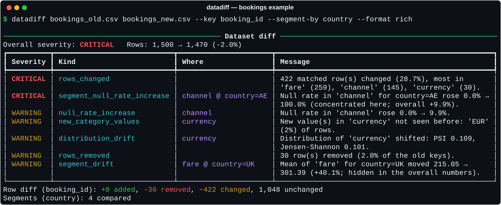

<p align="center">
  
</p>

<p align="center">
  <a href="https://pypi.org/project/datadiff-engine/"></a>
  <a href="https://github.com/Rohesen/datadiff-engine/actions/workflows/tests.yml"></a>
  <a href="https://www.python.org/"></a>
  <a href="https://github.com/Rohesen/datadiff-engine/blob/main/pyproject.toml"></a>
  <a href="https://github.com/Rohesen/datadiff-engine/blob/main/SECURITY.md"></a>
  <a href="https://github.com/Rohesen/datadiff-engine/blob/main/LICENSE.txt"></a>
  <a href="https://pypi.org/project/datadiff-engine/"></a>
</p>

<p align="center">
  <b>Catch silent data regressions before they reach your dashboards.</b><br>
  Schema changes · null spikes · statistical drift · added, removed and changed rows · problems hidden inside one subgroup
</p>

<p align="center">
  <a href="#-quick-start">Quick start</a> ·
  <a href="#-what-it-catches">What it catches</a> ·
  <a href="#-segment-analysis">Segments</a> ·
  <a href="#-cli">CLI</a> ·
  <a href="#%EF%B8%8F-configuration">Configuration</a> ·
  <a href="#-how-it-works">How it works</a> ·
  <a href="https://github.com/Rohesen/datadiff-agent">AI agent</a>
</p>

---

## 🤔 Why datadiff?

Data pipelines rarely crash when the data goes wrong. They load it. A feed silently stops sending a column for one market, a currency code changes, or one region's prices arrive in the wrong unit, and every job still finishes green. You find out when someone asks why the dashboard looks off.

`datadiff-engine` compares today's data with yesterday's and tells you what changed, how serious it is, and where:

- **One call or one command.** `compare(old, new)` or `datadiff old.csv new.csv`.
- **Answers you can act on.** A ranked list of issues with `INFO` / `WARNING` / `CRITICAL` severity, plus an exit code for CI and orchestrators.
- **Finds what averages hide.** Segment analysis catches a problem in one country or channel that the overall numbers smooth away.
- **Grounded in standard statistics.** PSI, Kolmogorov–Smirnov and Jensen–Shannon distance, checked against SciPy, with sample-size guards against false alarms.
- **Fits your stack.** pandas, Polars, DuckDB and Arrow inputs; CSV, Parquet, JSON and Feather files; text, coloured terminal, JSON, Markdown and HTML reports.
- **Lightweight and safe.** The only hard dependency is pandas. The code is fully typed and scanned in CI by Bandit and pip-audit.

<p align="center">
  
</p>

In this example, the 40% fare jump in the UK doesn't show in the overall fare figures. Without `--segment-by` it goes unnoticed; with it, datadiff points straight at it.

## 📦 Install

```bash
pip install datadiff-engine
```

Requires Python 3.10+. The core install only needs pandas; add extras as you need them:

| Extra | Adds |
|---|---|
| `datadiff-engine[parquet]` | Parquet and Feather files (pyarrow) |
| `datadiff-engine[polars]` | Polars DataFrame and LazyFrame inputs |
| `datadiff-engine[duckdb]` | DuckDB relations, and `--duckdb` in the CLI |
| `datadiff-engine[rich]` | Coloured terminal output (`--format rich`) |
| `datadiff-engine[all]` | Everything above |

## 🚀 Quick start

### From the command line

```bash
# Clone the repo to try the bundled example, or point it at your own files
datadiff examples/bookings_old.csv examples/bookings_new.csv \
    --key booking_id --segment-by country --fail-on critical
```

The exit code is `0` when everything is fine and `1` when the `--fail-on` level is reached, so the command can gate a pipeline as it is.

### From Python

```python
import pandas as pd
from datadiff_engine import compare

old = pd.read_csv("bookings_old.csv")
new = pd.read_csv("bookings_new.csv")

diff = compare(old, new, key="booking_id", segment_by="country")

print(diff.overall_severity)        # CRITICAL
for issue in diff.issues():         # most severe first
    print(issue.severity, issue.kind, issue.column, issue.segment)
```

```text
CRITICAL rows_changed None None
CRITICAL segment_null_rate_increase channel country=AE
WARNING null_rate_increase channel None
WARNING new_category_values currency None
WARNING distribution_drift currency None
WARNING rows_removed None None
WARNING segment_drift fare country=UK
```

`print(diff)` gives the full text report, and `diff.to_dict()` gives everything as strict JSON.

### As a quality gate in a pipeline

```python
diff = compare(yesterday, today, key="booking_id", segment_by="country")

if diff.overall_severity == "CRITICAL":
    raise RuntimeError("Bad batch, not loading it:\n" + diff.to_text())
```

The same pattern works in Airflow, Dagster, Databricks jobs, cron, or any orchestrator that can run Python or a shell command.

## 🔍 What it catches

| Check | Catches | Issue kinds |
|---|---|---|
| Row counts | Unexpected growth, drops and empty loads | `row_count_change`, `empty_dataset` |
| Schema | Added or removed columns, type changes | `column_added`, `column_removed`, `type_changed` |
| Null rates | Columns that silently start arriving empty | `null_rate_increase` |
| Categories | Values never seen before, such as a new currency or status code | `new_category_values` |
| Summary drift | Mean, median or P95 moving past a threshold | `numeric_drift` |
| Statistical drift | Shifts in distribution shape, measured by PSI, KS and Jensen–Shannon | `distribution_drift` |
| Freshness | Timestamps that did not move forward (stale loads) | `stale_data` |
| Row diff (`key=`) | Added, removed and changed rows; duplicate and null keys | `rows_added`, `rows_removed`, `rows_changed`, `duplicate_keys`, `null_keys` |
| Segments (`segment_by=`) | Problems hidden inside one subgroup | `segment_null_rate_increase`, `segment_drift`, `segment_missing`, `segment_new`, `segment_share_shift` |

<details>
<summary><b>Full list of issue kinds and severities</b></summary>

| Issue kind | When | Severity |
|---|---|---|
| `empty_dataset` | The new dataset has no rows (the old one had some) | 🔴 CRITICAL |
| `row_count_change` | Row count moved past the configured % | 🟡 WARNING / 🔴 CRITICAL |
| `column_removed` | A column disappeared | 🔴 CRITICAL |
| `column_added` | A new column appeared | 🔵 INFO |
| `type_changed` | A column's data type changed (INFO when only caused by new missing values) | 🟡 WARNING |
| `null_rate_increase` | Null rate rose past the configured thresholds | 🟡 WARNING / 🔴 CRITICAL |
| `new_category_values` | A low-cardinality column has values never seen before | 🟡 WARNING |
| `numeric_drift` | Mean, median or P95 moved past `drift_threshold_pct` | 🟡 WARNING |
| `distribution_drift` | PSI past `psi_warning` / `psi_critical`; numeric columns also need a significant KS test | 🟡 WARNING / 🔴 CRITICAL |
| `stale_data` | The latest timestamp in a `freshness_columns` column did not move forward | 🟡 WARNING |
| `duplicate_keys` | The key is not unique | 🟡 WARNING (old) / 🔴 CRITICAL (new) |
| `null_keys` | The key has missing values | 🟡 WARNING |
| `rows_removed` / `rows_changed` | Share of keys removed / changed, against the configured % | 🔵 INFO / 🟡 WARNING / 🔴 CRITICAL |
| `rows_added` | New keys | 🔵 INFO |
| `segment_missing` | A segment no longer has any rows | 🟡 WARNING |
| `segment_new` | A new segment appeared | 🔵 INFO |
| `segment_share_shift` | A segment's share of rows moved by `segment_share_shift` or more | 🟡 WARNING |
| `segment_null_rate_increase` | Null rate rose inside a segment, hidden or concentrated | 🟡 WARNING / 🔴 CRITICAL |
| `segment_drift` | A numeric mean moved inside a segment, hidden or concentrated | 🟡 WARNING |

The list is also available in code as `datadiff_engine.ISSUE_KINDS`. Issue kinds are a stable contract: new kinds may be added in minor releases, and existing ones are never renamed.

</details>

## 📊 Statistical drift

For each column with at least `min_rows_for_tests` values (default 50) in both datasets, datadiff runs the standard drift measures:

| Column type | Measures |
|---|---|
| Numeric | **PSI** (population stability index) and the two-sample **Kolmogorov–Smirnov** test |
| Categorical | **PSI** over categories and **Jensen–Shannon distance** (0 = identical, 1 = disjoint) |

```python
dist = diff.column("fare").distribution
print(dist.psi, dist.ks_statistic, dist.ks_p_value, dist.severity)
```

Severity follows the usual PSI convention: below 0.1 is stable, 0.1–0.25 is a moderate shift (WARNING), and above 0.25 is a major shift (CRITICAL). A numeric column is only flagged when the KS test is also significant, so small samples don't raise false alarms. These tests catch changes in **shape** too, such as a column whose spread doubled while its mean stayed the same. ID columns can be excluded with `ignored_columns`, and date columns are skipped automatically.

## 🔑 Row-level diff

Pass the column(s) that identify a row, and datadiff matches rows on them. Row order doesn't matter.

```python
diff = compare(old, new, key="booking_id")          # or key=["flight_no", "flight_date"]

rd = diff.row_diff
rd.rows_added, rd.rows_removed, rd.rows_changed, rd.rows_unchanged   # (0, 30, 422, 1048)
rd.changed_by_column    # {"fare": 259, "channel": 145, "currency": 30}
rd.sample_changed[0]    # {"key": {"booking_id": 100001}, "changes": {"fare": [157.48, 220.47]}}
```

Two missing values count as equal. Small numeric differences can be ignored with `numeric_abs_tolerance` and `numeric_rel_tolerance`, and duplicate or missing keys are reported as their own issues.

## 🧩 Segment analysis

Overall numbers can hide problems in a single subgroup. If one country's `channel` column becomes 100% null, the overall null rate may only rise a few percent. A price change in one market can be lost among all the others, or cancelled out by a change in the opposite direction elsewhere.

`segment_by` repeats the checks inside every segment:

```python
diff = compare(old, new, segment_by="country")       # or ["country", "channel"]
```

```text
[CRITICAL] Null rate in 'channel' for country=AE rose 0.0% → 100.0% (concentrated here; overall +9.9%).
[WARNING] Mean of 'fare' for country=UK moved 215.05 → 301.39 (+40.1%; hidden in the overall numbers).
```

A segment-level change is reported when it is:

- **hidden:** the dataset-level check didn't flag that column at all, or
- **concentrated:** at least 1.5× the overall change, so you know *where* it comes from.

A change spread evenly across every segment is reported once, at dataset level, so the report isn't flooded with duplicates. Segment drift is also checked with a KS test, so small segments don't raise false alarms. Missing segments, new segments and big shifts in a segment's share of rows are reported too.

## 🕒 Dates and freshness

Date columns, whether datetime types or date-like text such as `2026-11-18`, get a date-range profile (`old_datetime_stats` / `new_datetime_stats`). List your event-time columns in `freshness_columns` to flag loads whose latest timestamp did not move forward:

```python
diff = compare(old, new, DiffConfig(freshness_columns={"booked_at"}))
```

## 🔌 pandas, Polars, DuckDB and Arrow

`compare` accepts pandas DataFrames, Polars DataFrames and LazyFrames, DuckDB relations and PyArrow tables, in any combination:

```python
import duckdb
import polars as pl

diff = compare(
    duckdb.sql("SELECT * FROM 'bookings_2026_11_17.parquet'"),
    pl.scan_parquet("bookings_2026_11_18.parquet"),
)
```

## 📝 Reports

| Method | Output |
|---|---|
| `print(diff)` / `diff.to_text()` | Plain-text report |
| `diff.to_markdown()` | Markdown, for pull-request comments, wikis and chat |
| `diff.to_html()` | A self-contained HTML page with no scripts and no external assets |
| `diff.to_dict()` | Strict JSON with a `schema_version`, ready for automation |
| `--format rich` (CLI) | Coloured terminal tables |

<details>
<summary><b>JSON output shape</b></summary>

```text
{
  "schema_version": "1.1",
  "summary":  { "overall_severity", "issue_count", "issues": [ {kind, severity, column, segment?, message, details?} ] },
  "rows":     { "old", "new", "change", "change_pct" },
  "schema":   { "added", "removed", "changed_types" },
  "columns":  { "<name>": { dtypes, null rates, unique counts, stats, drift, distribution, datetime ranges } },
  "row_diff": { ... } | null,
  "segments": { ... } | null,
  "config":   { the thresholds that were used }
}
```

Values JSON cannot represent, such as infinity or NaN, are written as `null`, so the output always parses as strict JSON.

</details>

## 💻 CLI

```bash
datadiff OLD NEW [options]
```

| Task | Command |
|---|---|
| Compare two files | `datadiff old.parquet new.parquet` |
| Row-level diff by key | `datadiff old.csv new.csv --key booking_id` |
| Segment analysis | `datadiff old.csv new.csv --segment-by country channel` |
| Freshness check | `datadiff old.csv new.csv --freshness-column booked_at` |
| Exclude ID columns from drift | `datadiff old.csv new.csv --ignore booking_id` |
| Choose an output format | `--format text\|json\|markdown\|html\|rich` (or `--json`) |
| Save the report | `datadiff old.csv new.csv --format html -o report.html` |
| Fail the job on critical issues | `datadiff old.csv new.csv --fail-on critical` |
| Tune thresholds | `--drift-threshold 10 --psi-critical 0.3 --critical-row-change 30` |
| Skip statistical tests | `datadiff old.csv new.csv --no-stats` |
| Compare DuckDB tables or queries | `datadiff --duckdb warehouse.duckdb orders "SELECT * FROM staging.orders"` |
| Load settings from a file | `datadiff old.csv new.csv --config datadiff.toml` |
| Help and version | `datadiff --help`, `datadiff --version` |

- **Files:** `.csv`, `.tsv`, `.parquet`, `.json`, `.jsonl`, `.feather`
- **Exit codes:** `0` OK · `1` the `--fail-on` level was reached · `2` bad input (missing file, unsupported format, bad option)
- **Errors** go to standard error, so `--json` output on standard output is always clean.
- **With `--duckdb`**, the database is opened **read-only**, with access to external files and the network turned off.

### In CI

```yaml
- name: Compare today's snapshot with yesterday's
  run: |
    pip install "datadiff-engine[parquet]"
    datadiff data/yesterday.parquet data/today.parquet \
      --key booking_id --segment-by country \
      --format markdown -o diff.md --fail-on critical

- name: Upload the report
  if: always()
  uses: actions/upload-artifact@v4
  with:
    name: datadiff-report
    path: diff.md
```

### Config file

Settings can live in a TOML file, in a `[datadiff]` table or under `[tool.datadiff]` in `pyproject.toml`. Command-line options override the file, and unknown keys are rejected, so typos never pass silently.

```toml
[tool.datadiff]
key = ["booking_id"]
segment_by = ["country"]
fail_on = "critical"
format = "markdown"
ignored_columns = ["booking_id"]
freshness_columns = ["booked_at"]
psi_critical = 0.3
warning_null_rate = 0.02
```

## ⚙️ Configuration

Every threshold lives in `DiffConfig`, and every one has a sensible default:

```python
from datadiff_engine import DiffConfig, compare

config = DiffConfig(
    warning_null_rate=0.02,
    ignored_columns={"booking_id"},
    freshness_columns={"booked_at"},
)
diff = compare(old, new, config, key="booking_id", segment_by="country")
```

<details>
<summary><b>All options and their defaults</b></summary>

| Option | Default | Meaning |
|---|---|---|
| `warning_null_rate` / `critical_null_rate` | `0.05` / `0.20` | Null-rate increase (0–1) for WARNING / CRITICAL |
| `ignored_columns` | none | Columns left out of drift analysis (IDs, hashes...) |
| `drift_threshold_pct` | `20.0` | % change in mean, median or P95 that counts as drift |
| `warning_row_change_pct` / `critical_row_change_pct` | `20.0` / `50.0` | % row-count change for WARNING / CRITICAL |
| `max_categories_for_new_value_check` | `50` | Only check columns with at most this many distinct values for new values and categorical drift |
| `new_value_min_share` | `0.01` | Ignore new values rarer than this share of rows |
| `statistical_tests` | `True` | Run PSI, KS and Jensen–Shannon |
| `min_rows_for_tests` | `50` | Minimum non-null values per side for statistical tests |
| `psi_warning` / `psi_critical` | `0.10` / `0.25` | PSI for WARNING / CRITICAL |
| `psi_bins` | `10` | Quantile bins for numeric PSI |
| `ks_alpha` | `0.01` | KS significance level required for numeric drift |
| `warning_changed_rows_pct` / `critical_changed_rows_pct` | `1.0` / `10.0` | % of rows removed or changed (with `key=`) for WARNING / CRITICAL |
| `numeric_abs_tolerance` / `numeric_rel_tolerance` | `0.0` / `0.0` | Numeric differences to ignore in the row diff |
| `sample_size` | `5` | Example rows kept for added / removed / changed |
| `max_segments` | `100` | Largest segments analysed |
| `min_segment_rows` | `30` | Minimum rows per side to compare a segment's columns |
| `min_segment_share` | `0.01` | Ignore missing / new segments smaller than this share |
| `segment_share_shift` | `0.05` | Change in a segment's share of rows that counts as a shift |
| `freshness_columns` | none | Timestamp columns whose latest value must move forward |

</details>

## 🧠 How it works

<p align="center">
  
</p>

<details>
<summary><b>Methodology details</b></summary>

- **Summary drift** (`numeric_drift`): the relative change in mean, median and P95 compared with `drift_threshold_pct`. It's fast, easy to explain, and works at any sample size.
- **PSI:** 10 quantile bins taken from the old data, with open-ended outer bins so new extremes are counted, and a 1e-4 floor on empty bins. Columns with 10 or fewer distinct values are compared value by value.
- **Kolmogorov–Smirnov:** the exact two-sample statistic (identical to SciPy) with an asymptotic p-value using Stephens' small-sample correction, within a few percent of SciPy's.
- **Jensen–Shannon:** distance in base 2, between 0 and 1.
- **Segments:** null rates and means are recomputed per segment. Findings are kept when they are hidden in the overall result or at least 1.5× the overall change, and segment drift must also pass a KS test. At most 25 findings of each kind are reported, largest first.
- **Nested values:** cells holding lists, arrays or dicts (common in Parquet) are compared by their JSON text.

Everything is implemented with NumPy and pandas; the test suite checks the results against SciPy.

</details>

## 🔒 Security

- No `eval`, `exec`, `pickle` or shell calls; files are read only as plain data formats.
- HTML and Markdown reports escape every value taken from the data, and HTML reports carry a Content-Security-Policy that blocks scripts.
- `--duckdb` opens the database read-only and sandboxed, with no file system or network access.
- The Parquet and Polars extras require `pyarrow >= 14.0.1`, which fixes CVE-2023-47248.
- Every change is checked in CI by Bandit, pip-audit, Ruff's security rules and mypy. Dependabot keeps dependencies up to date.

Please report vulnerabilities privately; see [SECURITY.md](https://github.com/Rohesen/datadiff-engine/blob/main/SECURITY.md).

## 🤖 datadiff-agent

**[datadiff-agent](https://github.com/Rohesen/datadiff-agent)** is an AI agent built on datadiff-engine. It inspects each new batch, reasons about what changed, and decides whether to load it, flag it or quarantine it. It is also available as an MCP server.

## 🗺️ Roadmap

- [x] Row, schema, null-rate and unique-value comparison
- [x] Issues with overall severity and a `--fail-on` quality gate
- [x] Statistical drift: PSI, Kolmogorov–Smirnov, Jensen–Shannon *(0.3.0)*
- [x] Key-based row-level diff *(0.3.0)*
- [x] Segment (subgroup) analysis *(0.3.0)*
- [x] Datetime profiling and freshness checks *(0.3.0)*
- [x] Polars, DuckDB and Arrow inputs *(0.3.0)*
- [x] Markdown, HTML and Rich reports; TOML config *(0.3.0)*
- [ ] Wasserstein distance and chi-square tests
- [ ] Multiple-testing correction across columns and segments
- [ ] Automatic discovery of drifting subgroups (no `segment_by` needed)
- [ ] Out-of-core comparison for files larger than memory

See the [changelog](https://github.com/Rohesen/datadiff-engine/blob/main/CHANGELOG.md) for release history.

## 🛠️ Development

<details>
<summary><b>Set up and run the checks</b></summary>

```bash
git clone https://github.com/Rohesen/datadiff-engine.git
cd datadiff-engine
python -m venv .venv && source .venv/bin/activate   # Windows: .\.venv\Scripts\Activate.ps1
pip install -e ".[all,dev]"
```

The same checks run in CI:

```bash
pytest --cov                        # tests, 90% coverage minimum
ruff check src tests                # lint, including security rules
mypy                                # type checks
bandit -c pyproject.toml -r src     # static security analysis
pip-audit --skip-editable           # known vulnerabilities in dependencies
```

To regenerate the bookings example: `python examples/make_bookings.py`.

</details>

<details>
<summary><b>Project structure</b></summary>

```text
src/datadiff_engine/
├── compare.py     # compare(), DatasetDiff, ColumnDiff
├── config.py      # DiffConfig
├── stats.py       # numeric, categorical and datetime profiles
├── drift.py       # summary drift, PSI, KS, Jensen-Shannon
├── rows.py        # key-based row diff
├── segments.py    # segment (subgroup) analysis
├── issues.py      # Issue and ISSUE_KINDS
├── report.py      # text, Markdown, HTML and Rich reports
└── cli.py         # the datadiff command
```

</details>

## 📚 Citing

If you use datadiff-engine in research, please cite it. GitHub's **"Cite this repository"** button uses [CITATION.cff](https://github.com/Rohesen/datadiff-engine/blob/main/CITATION.cff).

## 🤝 Feedback

Bug reports and ideas are welcome in [Issues](https://github.com/Rohesen/datadiff-engine/issues). If datadiff saved you from a bad load, a ⭐ helps others find it.

## 📄 License

MIT. See [LICENSE](https://github.com/Rohesen/datadiff-engine/blob/main/LICENSE.txt).

<p align="center"><sub>Built by <b>Rohesen Rajkamal Maurya</b> · data engineer</sub></p>
